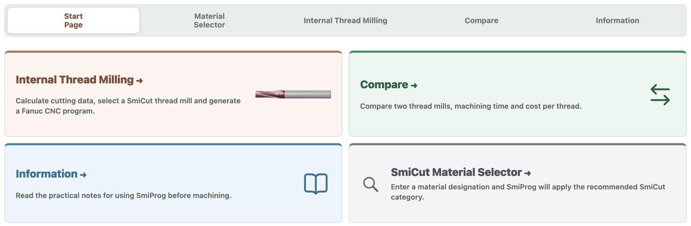

<h1> SmiProg</h1>

**Free thread-milling software. Calculate cutting data, select a tool and generate a CNC program.**

[**Use online**](https://smicut.com/en/smiprog-online/) · [**Download SmiProg**](#download-the-published-release) · [**Adapt for your company**](REBRANDING.md)

Made by [SmiCut](https://smicut.com). Free to use and adapt, including commercial use.
SmiProg helps you choose thread mills, calculate cutting data and machining time,
generate CNC programs, and compare tooling costs.

Use the same complete HTML file on your own website: paste its contents into a
Raw HTML block. [Website installation guide](docs/website-embedding.md).

## All 16 language editions

The source includes all 16 languages and the updated Compare workflow.
The links below open each generated HTML review page in the repository:

| Language | Language |
|---|---|
| [English](apps/web/languages/en.html) | [Svenska](apps/web/languages/sv.html) |
| [Dansk](apps/web/languages/da.html) | [Deutsch](apps/web/languages/de.html) |
| [Español](apps/web/languages/es.html) | [Français](apps/web/languages/fr.html) |
| [Magyar](apps/web/languages/hu.html) | [Bahasa Indonesia](apps/web/languages/id.html) |
| [Italiano](apps/web/languages/it.html) | [日本語](apps/web/languages/ja.html) |
| [한국어](apps/web/languages/ko.html) | [Nederlands](apps/web/languages/nl.html) |
| [Polski](apps/web/languages/pl.html) | [Русский](apps/web/languages/ru.html) |
| [简体中文](apps/web/languages/zh.html) | [繁體中文（台灣）](apps/web/languages/zh-tw.html) |

For local review, open `apps/web/languages/index.html` from a complete checkout.
Run `npm run build:languages` to generate complete single-file HTML editions in
`dist/downloads/`. See [language review](docs/languages.md).
Source changes do not automatically update the live website or release downloads.

## Download the published release

**One HTML file contains the app, tool data and all images.** No installation,
ZIP extraction, image folders or GitHub account is needed.

| Language | Use online | Download complete app |
|---|---|---|
| English | [Open SmiProg](https://smicut.com/en/smiprog-online/) | [Download smiprog-en.html](https://github.com/SmiCut/smiprog/releases/latest/download/smiprog-en.html) |
| Svenska | - | [Download smiprog-sv.html](https://github.com/SmiCut/smiprog/releases/latest/download/smiprog-sv.html) |
| Dansk | - | [Download smiprog-da.html](https://github.com/SmiCut/smiprog/releases/latest/download/smiprog-da.html) |
| Deutsch | - | [Download smiprog-de.html](https://github.com/SmiCut/smiprog/releases/latest/download/smiprog-de.html) |
| Español | - | [Download smiprog-es.html](https://github.com/SmiCut/smiprog/releases/latest/download/smiprog-es.html) |
| Français | - | [Download smiprog-fr.html](https://github.com/SmiCut/smiprog/releases/latest/download/smiprog-fr.html) |
| Magyar | - | [Download smiprog-hu.html](https://github.com/SmiCut/smiprog/releases/latest/download/smiprog-hu.html) |
| Bahasa Indonesia | - | [Download smiprog-id.html](https://github.com/SmiCut/smiprog/releases/latest/download/smiprog-id.html) |
| Italiano | - | [Download smiprog-it.html](https://github.com/SmiCut/smiprog/releases/latest/download/smiprog-it.html) |
| 日本語 | - | [Download smiprog-ja.html](https://github.com/SmiCut/smiprog/releases/latest/download/smiprog-ja.html) |
| 한국어 | - | [Download smiprog-ko.html](https://github.com/SmiCut/smiprog/releases/latest/download/smiprog-ko.html) |
| Nederlands | - | [Download smiprog-nl.html](https://github.com/SmiCut/smiprog/releases/latest/download/smiprog-nl.html) |
| Polski | - | [Download smiprog-pl.html](https://github.com/SmiCut/smiprog/releases/latest/download/smiprog-pl.html) |
| Русский | - | [Download smiprog-ru.html](https://github.com/SmiCut/smiprog/releases/latest/download/smiprog-ru.html) |
| 简体中文 | - | [Download smiprog-zh.html](https://github.com/SmiCut/smiprog/releases/latest/download/smiprog-zh.html) |
| 繁體中文（台灣） | - | [Download smiprog-zh-tw.html](https://github.com/SmiCut/smiprog/releases/latest/download/smiprog-zh-tw.html) |

Version 1.1.0 includes all 16 languages and the updated Compare workflow.
Each download includes its selected language, tool data, images and license notices.

## Open your download in three steps

1. Choose your language's **Download** link above.
2. Find the file in your Downloads folder.
3. Double-click it to open SmiProg in your web browser. If asked, choose a browser.

The calculators, CNC generation, tool comparison and images work offline.
Choose a material category manually when working offline. External product links
need internet. The **AI Material Selector needs internet and an approved website**;
opening the downloaded file on your computer does not enable the hosted AI service.
Use the online version for AI-assisted selection.

[Help opening the file and using it on your website](docs/getting-started.md) · [Latest release and changes](https://github.com/SmiCut/smiprog/releases/latest)

## What can I do?

- Select thread dimensions, workpiece material and a suggested SmiCut tool.
- Enter custom tool dimensions or the laser-marked diameter on a catalogue tool.
- Calculate cutting data and machining time.
- Generate CNC programs for supported Fanuc / ISO and Heidenhain configurations.
- Compare two tools, machining times and costs using your own prices.

Compare is open to everyone. `XL` reveals EUR catalogue
prices; Swedish SEK reference prices are visible directly. The code is a display
convenience, not a security feature. Prices are editable and are not a quotation.

**Verify the CNC program for your controller, machine and setup before machining.**
Heidenhain supports right- and left-hand vertical milling; Heidenhain lathe thread
milling is not supported. See [supported configurations and verification limits](docs/calculations/cnc-motion-and-validation.md).

## Make it your own

Use your own company name, logo, colours, product links and reference prices.
You may change the software, offer it commercially and keep your changes private.

There is no built-in branding editor. A web developer can help edit the app.
Keep the included copyright, MIT license and third-party icon notices; these are
already embedded in the HTML and do not require visible branding in your interface.

[**Read the customization guide**](REBRANDING.md) · [**Use SmiProg on your website**](docs/getting-started.md#use-smiprog-on-your-website)

## Help and further information

[Browse the documentation](docs/README.md)

- **Using SmiProg:** email [info@smicut.se](mailto:info@smicut.se).
- **AI access for your own website:** follow the [Material Selector guide](MATERIAL_SELECTOR.md).
- **Report a problem:** [open an issue](https://github.com/SmiCut/smiprog/issues).
- **For developers:** [source files, tests and builds](docs/development.md), [contributing](.github/CONTRIBUTING.md), and [MIT license](LICENSE).
- **Tapping, thread turning, grooving, milling and drilling:** see [SmiCalc](https://github.com/SmiCut/smicalc).

For contributors: [what belongs in this public project](docs/publication-policy.md).
