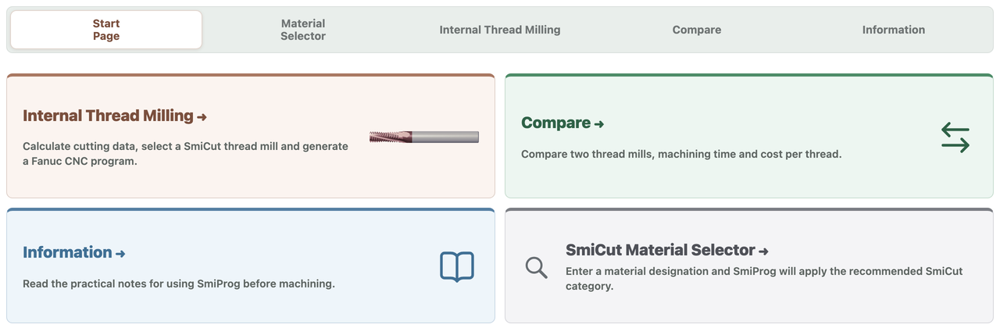

<h1> SmiProg</h1>

**Free thread-milling software. Calculate cutting data, select a tool and generate a CNC program.**

[**Use online**](https://smicut.com/en/smiprog-online-software-for-thread-milling/) · [**Download SmiProg**](#download-the-published-release) · [**Adapt for your company**](REBRANDING.md)

Made by [SmiCut](https://smicut.com). Free to use and adapt, including commercial use.
SmiProg helps you choose thread mills, calculate cutting data and machining time,
generate CNC programs, and compare tooling costs.

Use the same complete HTML file on your own website: paste its contents into a
Raw HTML block. [Website installation guide](docs/website-embedding.md).

## Choose your next step

| I want to… | Start here |
|---|---|
| Try SmiProg | [Open the online app](https://smicut.com/en/smiprog-online-software-for-thread-milling/) or choose a language below. |
| Add it to my website | [Install the complete HTML file](docs/website-embedding.md). |
| Create my own branded version | [Follow the reseller customization example](REBRANDING.md). |

The ready-to-use download is a **web app**. It runs in a browser, on your website,
or offline from the HTML file. A separately published iPhone or Android app needs
additional development, packaging and store publication; this repository does not
supply a ready-to-submit mobile app project.

## Download the published release

**One HTML file contains the app, tool data and all images.** No installation,
ZIP extraction, image folders or GitHub account is needed.

| Language | Use online | Download complete app |
|---|---|---|
| English | [Open SmiProg](https://smicut.com/en/smiprog-online-software-for-thread-milling/) | [Download smiprog-en.html](https://github.com/SmiCut/smiprog/releases/latest/download/smiprog-en.html) |
| Svenska | [Open SmiProg](https://smicut.com/sv/smiprog-online-programvara-for-gangfrasning/) | [Download smiprog-sv.html](https://github.com/SmiCut/smiprog/releases/latest/download/smiprog-sv.html) |
| Dansk | [Open SmiProg](https://smicut.com/da/smiprog-online-software-til-gevindfraesning/) | [Download smiprog-da.html](https://github.com/SmiCut/smiprog/releases/latest/download/smiprog-da.html) |
| Deutsch | [Open SmiProg](https://smicut.com/de/smiprog-online-software-zum-gewindefraesen/) | [Download smiprog-de.html](https://github.com/SmiCut/smiprog/releases/latest/download/smiprog-de.html) |
| Español | [Open SmiProg](https://smicut.com/es/smiprog-online-software-para-fresado-de-roscas/) | [Download smiprog-es.html](https://github.com/SmiCut/smiprog/releases/latest/download/smiprog-es.html) |
| Français | [Open SmiProg](https://smicut.com/fr/smiprog-online-logiciel-de-fraisage-de-filets/) | [Download smiprog-fr.html](https://github.com/SmiCut/smiprog/releases/latest/download/smiprog-fr.html) |
| Magyar | [Open SmiProg](https://smicut.com/hu/smiprog-online-menetmaro-szoftver/) | [Download smiprog-hu.html](https://github.com/SmiCut/smiprog/releases/latest/download/smiprog-hu.html) |
| Bahasa Indonesia | [Open SmiProg](https://smicut.com/id/smiprog-online-software-untuk-thread-milling/) | [Download smiprog-id.html](https://github.com/SmiCut/smiprog/releases/latest/download/smiprog-id.html) |
| Italiano | [Open SmiProg](https://smicut.com/it/smiprog-online-software-per-la-fresatura-dei-filetti/) | [Download smiprog-it.html](https://github.com/SmiCut/smiprog/releases/latest/download/smiprog-it.html) |
| 日本語 | [Open SmiProg](https://smicut.com/ja/smiprog-online-%e3%81%ad%e3%81%98%e3%83%95%e3%83%a9%e3%82%a4%e3%82%b9%e5%8a%a0%e5%b7%a5%e7%94%a8%e3%82%bd%e3%83%95%e3%83%88%e3%82%a6%e3%82%a7%e3%82%a2/) | [Download smiprog-ja.html](https://github.com/SmiCut/smiprog/releases/latest/download/smiprog-ja.html) |
| 한국어 | [Open SmiProg](https://smicut.com/ko/smiprog-online-%eb%82%98%ec%82%ac-%eb%b0%80%eb%a7%81%ec%9a%a9-%ec%86%8c%ed%94%84%ed%8a%b8%ec%9b%a8%ec%96%b4/) | [Download smiprog-ko.html](https://github.com/SmiCut/smiprog/releases/latest/download/smiprog-ko.html) |
| Nederlands | [Open SmiProg](https://smicut.com/nl/smiprog-online-software-voor-draadfrezen/) | [Download smiprog-nl.html](https://github.com/SmiCut/smiprog/releases/latest/download/smiprog-nl.html) |
| Polski | [Open SmiProg](https://smicut.com/pl/smiprog-online-oprogramowanie-do-frezowania-gwintow/) | [Download smiprog-pl.html](https://github.com/SmiCut/smiprog/releases/latest/download/smiprog-pl.html) |
| Русский | [Open SmiProg](https://smicut.com/ru/smiprog-online-%d0%bf%d1%80%d0%be%d0%b3%d1%80%d0%b0%d0%bc%d0%bc%d0%b0-%d0%b4%d0%bb%d1%8f-%d1%84%d1%80%d0%b5%d0%b7%d0%b5%d1%80%d0%be%d0%b2%d0%b0%d0%bd%d0%b8%d1%8f-%d1%80%d0%b5%d0%b7%d1%8c%d0%b1%d1%8b/) | [Download smiprog-ru.html](https://github.com/SmiCut/smiprog/releases/latest/download/smiprog-ru.html) |
| 简体中文 | [Open SmiProg](https://smicut.com/zh/smiprog-online-%e8%9e%ba%e7%ba%b9%e9%93%a3%e5%89%8a%e8%bd%af%e4%bb%b6/) | [Download smiprog-zh.html](https://github.com/SmiCut/smiprog/releases/latest/download/smiprog-zh.html) |
| 繁體中文（台灣） | [Open SmiProg](https://smicut.com/zh-tw/smiprog-online-%e8%9e%ba%e7%b4%8b%e9%8a%91%e5%89%8a%e8%bb%9f%e9%ab%94/) | [Download smiprog-zh-tw.html](https://github.com/SmiCut/smiprog/releases/latest/download/smiprog-zh-tw.html) |

Use **Print** next to Cutting data, CNC Program or Compare results to preview the report, print it or save it as PDF. Opening Print from CNC Program includes the program by default. All 16 editions include localized reports. The [iOS integration kit](ios-print/README.md) uses these same offline editions.

Version 1.2.4 reviews the complete information tab in all 16 languages against
the original SmiProg terminology and the current web controls. It clarifies tool
compensation, spiral cycles, custom tools and indexable inserts. The shared iOS
translations retain reviewed web corrections when imported again. Swedish
V-profil terminology and the reseller customization example remain included.
Online pages are available in all 20 SmiCut language and market variants.
The calculator information buttons, inline Compare discounts and corrected CNC
process menu remain included.
Currency and percent symbols remain visible inside Compare inputs while editing.
Each download includes its selected language, tool data, images and license notices.

## Open your download in three steps

1. Choose your language's **Download** link above.
2. Find the file in your Downloads folder.
3. Double-click it to open SmiProg in your web browser. If asked, choose a browser.

The calculators, CNC generation, tool comparison and images work offline.
Choose a material category manually when working offline. External product links
need internet. The **AI Material Selector needs internet and an approved website**;
opening the downloaded file on your computer does not enable the hosted AI service.
Use the online version for AI-assisted selection.

[Help opening the file and using it on your website](docs/getting-started.md) · [Latest release and changes](https://github.com/SmiCut/smiprog/releases/latest)

## What can I do?

- Select thread dimensions, workpiece material and a suggested SmiCut tool.
- Enter custom tool dimensions or the laser-marked diameter on a catalogue tool.
- Calculate cutting data and machining time.
- Generate CNC programs for supported Fanuc / ISO and Heidenhain configurations.
- Compare two tools, machining times and costs using your own prices.

Compare is open to everyone. `XL` reveals EUR catalogue
prices; Swedish SEK reference prices are visible directly. The code is a display
convenience, not a security feature. Prices are editable and are not a quotation.

**Verify the CNC program for your controller, machine and setup before machining.**
Heidenhain supports right- and left-hand vertical milling; Heidenhain lathe thread
milling is not supported. See [supported configurations and verification limits](docs/calculations/cnc-motion-and-validation.md).

## Make it your own

Use your own company name, logo, colours, product links and reference prices.
You may change the software, offer it commercially and keep your changes private.

There is no built-in branding editor. A web developer can help edit the app.
Keep the included copyright, MIT license and third-party icon notices; these are
already embedded in the HTML and do not require visible branding in your interface.

[**Read the customization guide**](REBRANDING.md) · [**Use SmiProg on your website**](docs/getting-started.md#use-smiprog-on-your-website)

## Help and further information

[Browse the documentation](docs/README.md)

- **Using SmiProg:** email [info@smicut.se](mailto:info@smicut.se).
- **AI access for your own website:** follow the [Material Selector guide](MATERIAL_SELECTOR.md).
- **Report a problem:** [open an issue](https://github.com/SmiCut/smiprog/issues).
- **For developers:** [source files, tests and builds](docs/development.md), [contributing](.github/CONTRIBUTING.md), and [MIT license](LICENSE).
- **Tapping, thread turning, grooving, milling and drilling:** see [SmiCalc](https://github.com/SmiCut/smicalc).

For developers: the editable text source is `apps/web/i18n/translations.csv`.
Run `npm run build:languages` to generate all 16 complete HTML editions in
`dist/downloads/`. Local source previews are in `apps/web/languages/index.html`.
[Set up a development copy](docs/development.md#developer-setup-and-editable-prices).

For contributors: [what belongs in this public project](docs/publication-policy.md).
